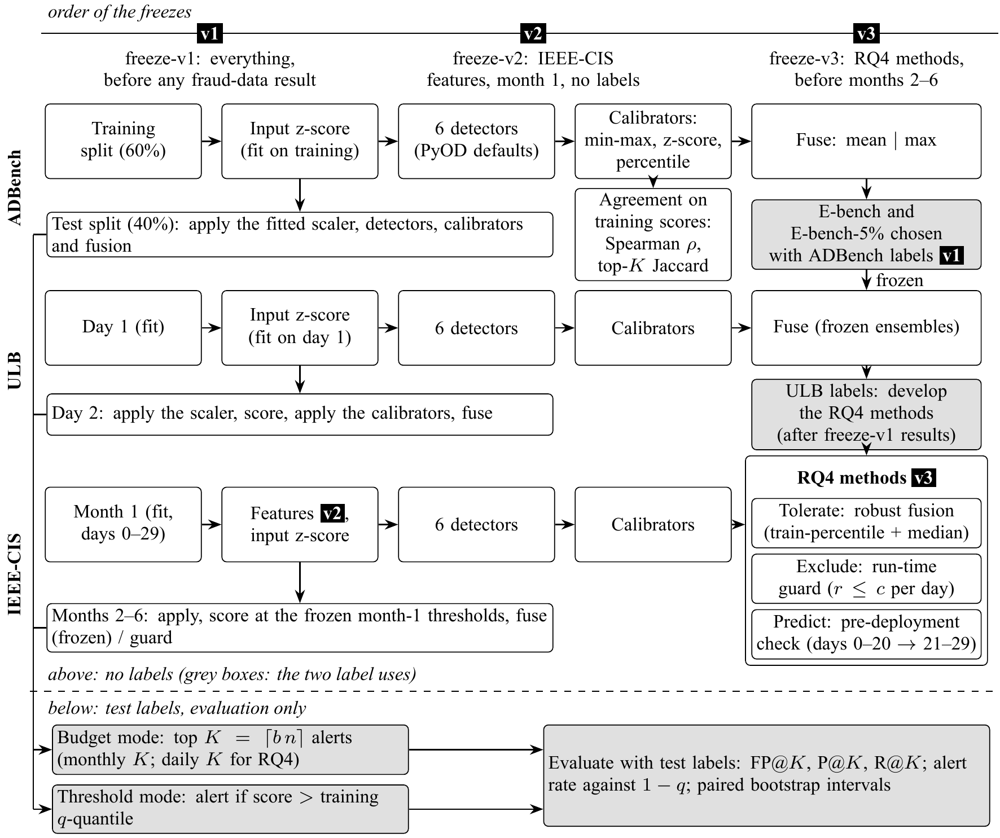
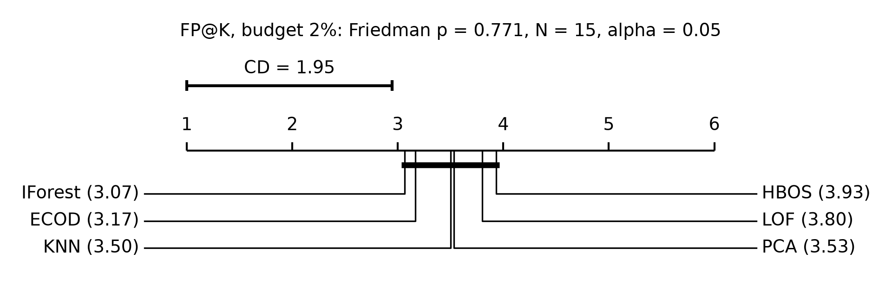
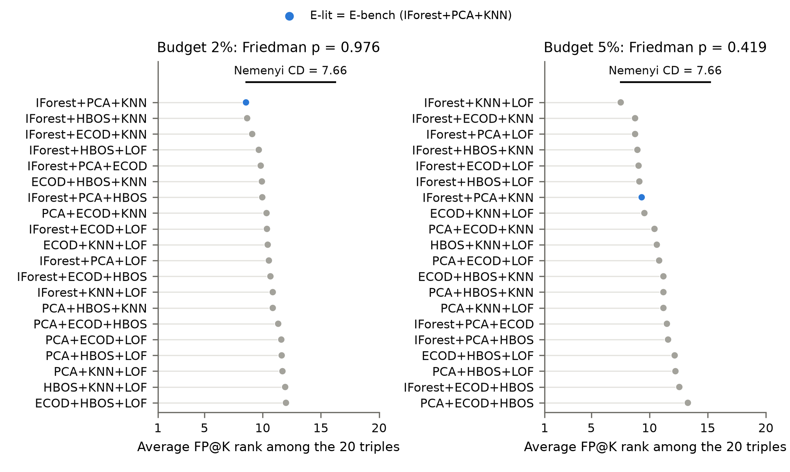
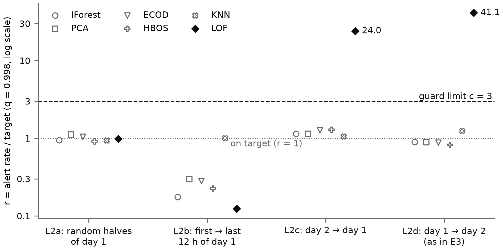
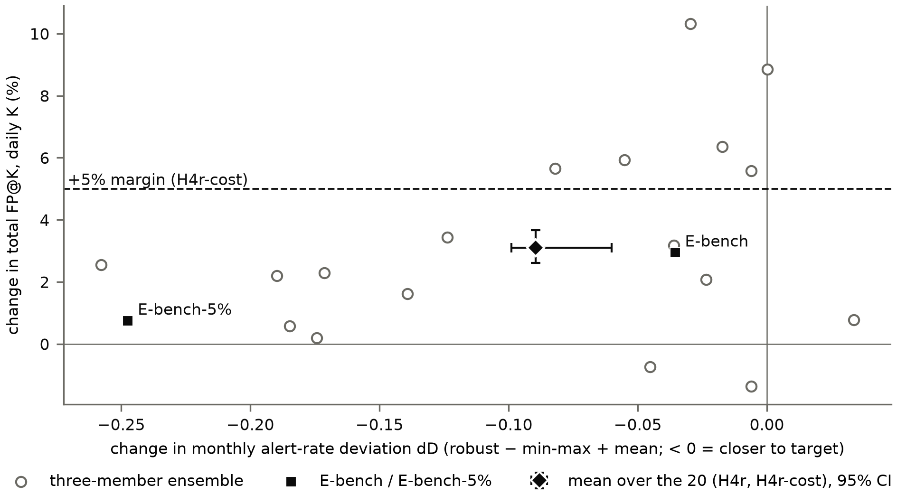
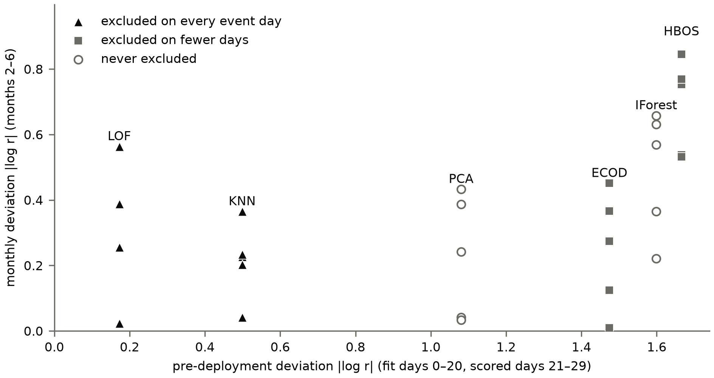

# Unsupervised Model Ensembling for False Alarm Reduction in Anomaly Detection


-green)


BSc thesis, Budapest University of Technology and Economics (BME), Faculty of Electrical Engineering and
Informatics (VIK), 2026.

**Md Asiruzzaman Rifat**

> The version behind the TDK paper is the tag `tdk-submitted` here and the archived repository
> [unsupervised-ensembling-false-alarms-tdk](https://github.com/RifatZaman0/unsupervised-ensembling-false-alarms-tdk).

---

## Overview

Anomaly detectors used in fraud and security monitoring raise more alerts than analysts can check, and most
of these alerts are false alarms. Labels are rarely available, so the detectors have to work unsupervised.
Ensembles of unsupervised detectors are often recommended, but earlier evaluations choose the members or the
operating point with labels, measure ranking quality instead of the alerts a team can actually review, and
test on random rather than later data.

This thesis asks: **does a small ensemble that is fixed without labels raise fewer false alarms at a fixed
alert budget, and what happens when one of its members breaks over time?**

- **Detectors:** Isolation Forest, PCA, ECOD, HBOS, KNN, LOF (PyOD defaults).
- **Ensembles:** all 15 pairs and 20 triples, three score normalisations (min-max, z-score, training
  percentile) × two fusion rules (mean, max). Every calibrator is fitted on training scores only.
- **Metric:** false positives among the top K alerts (**FP@K**), with K = ceil(budget × n) and ties at the
  K-th score split in expectation. AUROC, AP, Precision@K and Recall@K are reported as well.
- **Benchmark stage:** 15 ADBench datasets at alert budgets of 2% and 5%; one triple (E-bench) is chosen by
  a rule declared in advance.
- **Fraud stage 1, ULB:** the frozen ensembles are fitted on day 1 and tested on day 2, in budget mode and
  with day-1 thresholds applied unchanged to day 2.
- **Fraud stage 2, IEEE-CIS:** fitted on month 1 and tested once on months 2–6.
- **A member that breaks (RQ4):** three label-free answers, developed on ULB and frozen before the IEEE-CIS
  run: tolerate it (robust fusion), detect and exclude it (a run-time guard), or predict it (a
  pre-deployment check).

```
 ADBench (15 datasets)            tag freeze-v1             ULB credit-card fraud       tag freeze-v2 / v3          IEEE-CIS
 ┌──────────────────────────┐    ┌───────────────────┐     ┌────────────────────────┐  ┌───────────────────────┐  ┌──────────────────────────┐
 │ E1  6 single detectors   │    │ ensembles, fusion,│     │ fit on day 1           │  │ v2: 26 features from  │  │ fit on month 1           │
 │ E2  15 pairs + 20 triples│ ─► │ budgets, thresh-  │ ──► │ test on day 2          │─►│ month 1, no labels    │─►│ single run, months 2–6   │
 │     × 6 fusion configs   │    │ olds, hypotheses, │     │ threshold transfer     │  │ v3: RQ4 methods       │  │ day-block bootstrap CIs  │
 │ E-bench selection rule   │    │ seeds, bootstrap  │     │ RQ4 methods developed  │  │ (robust fusion, guard,│  │ RQ4: tolerate / exclude /│
 │ FP@K at 2% and 5%        │    │                   │     │                        │  │ pre-deployment check) │  │ predict                  │
 └──────────────────────────┘    └───────────────────┘     └────────────────────────┘  └───────────────────────┘  └──────────────────────────┘
```

<p align="center"></p>

## Key findings

All numbers below are read from the files in [`results/`](results/); each file records the code commit
that produced it (see [Provenance](#provenance)).

**1. On the benchmark, no single detector stands out.** The six detectors cannot be told apart by FP@K at
the 2% budget (Friedman p = 0.771, 15 datasets).

<p align="center"></p>

**2. Ensembles insure, they rarely win.** With min-max normalisation and mean fusion at 2%, triples raised
fewer false alarms than their *median* member in 66.0% of the 300 triple–dataset cells, but fewer than their
*best* member in only 6.0%.

<p align="center"></p>

**3. Agreement on training data does not tell which members to combine.** The result has two parts.
Against the best member, combinations whose members agreed more on the training data lost less, the
opposite of the prediction (pooled Spearman ρ = +0.255 at 2%). Against the median member, the association
had the predicted direction but was weak (ρ = −0.112 at 2%). The comparator was not fixed in advance, so
both are reported.

**4. On ULB, the frozen ensemble matches the typical detector, not default Isolation Forest.** On ULB day 2
(140,021 transactions, 211 frauds, K = 281 alerts at the 0.2% budget), the frozen triple
IForest + PCA + KNN (min-max + mean) raised:

| Comparison | ΔFP@K | 95% bootstrap CI | Result under the frozen criterion |
|---|---|---|---|
| vs. median single detector | −0.8 | [−2.7, +2.4] | no difference shown |
| vs. default Isolation Forest | +2.4 | [+1.2, +5.8] | no difference shown (CI entirely above 0: more false alarms) |

**5. Thresholds transfer unless a member breaks.** The frozen ensemble's day-1 threshold (q = 0.998) gave a
day-2 alert rate of 0.1873% for a 0.2% target; LOF's gave 8.2202%. In control splits inside day 1, LOF
stayed near its target; it overshot only across days (r = 41.1 from day 1 to day 2).

<p align="center"></p>

**6. IEEE-CIS, single frozen run: the ensemble does no better than a detector picked without labels.**
Months 2–6 (152 days, 456,201 transactions), budget 2%, one alert budget per month, false alarms summed over
the five months, 95% month-stratified day-block bootstrap CIs:

| Hypothesis | Comparison | ΔFP@K | 95% CI | IEEE-CIS | Over both datasets |
|---|---|---|---|---|---|
| H1a | E-bench vs. median single detector | +25.9 | [−13.6, +68.3] | no difference shown | not supported |
| H1b | E-bench vs. default Isolation Forest | +224.4 | [+183.6, +274.0] | no difference shown (more false alarms) | not supported |

Thresholds from month 1 did not hold the target alert rate either: at q = 0.99, E-bench stayed farther from
its 1% target than the median single detector (H3a not supported).

**7. Robust fusion keeps the alert rate closer to its target at a small cost.** Replacing min-max + mean
with training-percentile calibration + median, over the 20 triples:

- the mean change in the monthly deviation |log r| was −0.0896 [−0.0989, −0.0602] (H4r supported); the
  typical monthly miss of the alert target shrank from a factor of 1.53 to 1.40, and 18 of the 20 triples
  improved;
- at a fixed daily alert count, false alarms rose by +3.11% [+2.62%, +3.67%], within the +5% margin fixed
  in advance (H4r-cost passes).

Members broke on single days in this run, but whether the improvement came from tolerating the broken
members was not isolated.

<p align="center"></p>

**8. Excluding broken members brought no gain; a pre-deployment check is a rough indicator.** The run-time
guard did no harm to E-bench (H4c: 0.0 [0.0, 0.0], no harm shown) and did not help E-all (H4b: +3.2
[−0.8, +10.0], not supported). A label-free check inside month 1 predicted how far each member's monthly
alert rate drifts (H4a: ρ = 0.545 [0.251, 0.725]), carried mostly by members that undershoot.

<p align="center"></p>

**9. Context (exploratory, no verdict).** ADTK flagged LOF's daily alert rate on 34 of the 152 test days.
Evidently flagged none of the 25 score-drift tests of E-bench. The weekly share of drifted features showed
no association with the weekly false positive rate (ρ = −0.037 [−0.506, 0.405]).

Small label-free ensembles insure against a bad choice of detector but do not beat a good one.

## Repository structure

```
.
├── frozen_config.json         # pre-registered protocol (tag freeze-v1)
├── frozen_features_v2.json    # IEEE-CIS feature rule and 26 features from month 1 (tag freeze-v2)
├── frozen_stress_v3.json      # RQ4 methods for the IEEE-CIS run (tag freeze-v3)
├── COMMIT_MAP.md              # original → published commit hashes (see Provenance)
├── data/manifest.json         # SHA-256 of the ADBench and ULB files (the data itself is not included)
├── docs/figures/pipeline.png  # pipeline figure
├── src/thesis/                # all code; every experiment is a module run with python -m thesis.<name>
│   ├── download.py            #   fetch ADBench (pinned commit) and ULB (Kaggle), verify checksums
│   ├── data.py                #   loaders, dataset selection rule, splits (stratified / temporal)
│   ├── detectors.py           #   the six detectors, z-scored inputs, train-only ECOD, rank-safe PCA
│   ├── fusion.py              #   normalisation (min-max, z-score, percentile) and fusion (mean, max, median)
│   ├── metrics.py, bootstrap.py  # FP@K and friends; paired and day-block bootstrap
│   ├── e1*.py, e2*.py, ebench.py # benchmark stage
│   ├── e3_ulb*.py, lof_diag.py   # ULB stage and LOF diagnosis
│   ├── robust_fusion.py, guard*.py, e_stress.py, fragility.py  # RQ4 methods (developed on ULB)
│   ├── ieee_features.py, ieee_stress.py, e3_ieee.py            # IEEE-CIS stage
│   ├── frozen.py, frozen_v3.py   # read and validate the frozen files
│   └── export_*.py            #   tables (CSV + LaTeX) and figures
├── tests/                     # unit tests and leakage tests
└── results/
    ├── tables/                # datasets/, setup/, e1/, e2/, robust_fusion/, e3_ulb/, ieee_cis/, sw/, cc/
    └── figures/               # e1/, e2/, e3_ulb/, ieee_cis/, sw/, cc/  (PDF + PNG)
```

Every output comes with a `*.meta.json` file that records the command, the commit and the inputs.
`results/tables/ieee_cis/run/` holds the outputs of the single IEEE-CIS run and `ieee_cis/ch5/` the tables
built from them. `sw/` and `cc/` are two further pre-registered side tests (spectral weighting, committee
cleaning; tags `prereg-sw`, `prereg-cc`); they are not part of the thesis results.

## Installation

Python 3.11 is required (pandas stays below 3, because ADTK 0.6.2 does not run on pandas 3).

```bash
git clone https://github.com/RifatZaman0/unsupervised-ensembling-false-alarms.git
cd unsupervised-ensembling-false-alarms
python -m venv .venv
.venv/bin/python -m pip install -r requirements-lock.txt      # Windows: .venv\Scripts\python.exe
```

Make `src/` importable before running anything. Outputs go to `results/` in this folder (set
`THESIS_PROJECT_DIR` to write them elsewhere).

```bash
export PYTHONPATH=src            # bash
```
```powershell
$env:PYTHONPATH = "src"          # PowerShell
```

## Data

The raw data is **not redistributed**.

| Dataset | Source | Use |
|---|---|---|
| ADBench (47 classical sets; 15 selected by the rule in `data.py`) | [Minqi824/ADBench](https://github.com/Minqi824/ADBench), commit `3dac822` pinned in `download.py` | E1, E2; stratified 60/40 split, 5 seeds |
| ULB credit-card fraud | Kaggle [`mlg-ulb/creditcardfraud`](https://www.kaggle.com/datasets/mlg-ulb/creditcardfraud) | day 1 (`Time` < 86,400 s) fit, day 2 test |
| IEEE-CIS fraud detection | Kaggle competition [`ieee-fraud-detection`](https://www.kaggle.com/competitions/ieee-fraud-detection), `train_transaction.csv` | month 1 (first 134,339 rows) fit, months 2–6 test |

ADBench and ULB are fetched and checked against `data/manifest.json` (a Kaggle API token is needed for ULB):

```bash
python -m thesis.download            # download what is missing, then verify
python -m thesis.download --verify   # verify only
```

IEEE-CIS is not fetched by the script. Accept the competition rules on Kaggle, then:

```bash
kaggle competitions download -c ieee-fraud-detection -f train_transaction.csv -p data/raw/ieee_cis
```

Keep it zipped as `data/raw/ieee_cis/train_transaction.csv.zip`. SHA-256 of the zip used here:
`d426943b810094085d572023df5e7d52e57d67f6e40d087bd88a3ebeae0b6c4a` (Kaggle may re-pack the zip; if the
hash differs, compare the unzipped CSV).

ADBench files are used as distributed, with their duplicates included, so this setup is not a full
reproduction of the ADBench protocol. A duplicate table and a duplicate-free robustness check are included
(`results/tables/datasets/duplicates.csv`, `results/tables/e1/variants/dedup/`).

## Reproducing the results

Run the steps in this order (later steps read the score cache that E1 and the ULB stage fill):

| Step | Command | Output |
|---|---|---|
| Dataset table | `python -m thesis.export_datasets` | `results/tables/datasets/` |
| E1: single detectors | `python -m thesis.e1` | `results/tables/e1/`, `results/figures/e1/` |
| E1: duplicate check | `python -m thesis.e1 --dedup`, then `python -m thesis.e1_dedup` | `results/tables/e1/variants/dedup/` |
| E2: pairs and triples | `python -m thesis.e2` | `results/tables/e2/`, `results/figures/e2/` |
| E-bench selection rule | `python -m thesis.ebench` | `results/tables/e2/ebench.md` |
| Setup tables | `python -m thesis.zero_variance`, `python -m thesis.export_setup` | `results/tables/setup/` |
| ULB, frozen protocol | `python -m thesis.e3_ulb` | `results/tables/e3_ulb/`, `results/figures/e3_ulb/` |
| ULB: LOF diagnosis | `python -m thesis.e3_ulb_lof`; `python -m thesis.lof_diag l0` (also `l2b`, `l2`) | `results/tables/e3_ulb/` |
| RQ4 development on ULB | `python -m thesis.robust_fusion`, `python -m thesis.e_stress`, `python -m thesis.guard_ulb`, `python -m thesis.export_stress` | `results/tables/robust_fusion/`, `results/tables/e3_ulb/stress/` |
| IEEE-CIS month 1 | `python -m thesis.ieee_features`, `python -m thesis.ieee_stress`, `python -m thesis.fragility` | `results/tables/ieee_cis/` |
| IEEE-CIS single run | `python -m thesis.e3_ieee --dry-run` (month 1, synthetic labels), then `python -m thesis.e3_ieee` | `results/tables/ieee_cis/run/` |
| IEEE-CIS exports | `python -m thesis.export_ch5` | `results/tables/ieee_cis/ch5/`, `results/figures/ieee_cis/` |

Detector scores are cached in `cache/scores/<key>/`. The key is a hash of the detector parameters, the
preprocessing and the PyOD version, so a changed setting never reuses old scores. The modules record the git
commit next to their outputs and refuse to write results from a working tree with uncommitted changes.

Run the tests with:

```bash
python -m pytest
```

Tests that need the raw data skip until it is downloaded. The LaTeX compile tests need XeLaTeX and the TDK
paper's preamble (`tdk/main.tex` under `THESIS_PROJECT_DIR`), so they skip here.

## Pre-registration

| Tag | File | What it fixed | Fixed before |
|---|---|---|---|
| `freeze-v1` | `frozen_config.json` | ensembles, fusion configurations, budgets, threshold quantiles, metrics, seeds, bootstrap, hypotheses with their decision criteria, baselines | any fraud-data result |
| `freeze-v2` | `frozen_features_v2.json` | the IEEE-CIS feature rule and its 26 features, built from month 1 without labels | any IEEE-CIS output after month 1 |
| `freeze-v3` | `frozen_stress_v3.json` | the RQ4 methods (robust fusion, run-time guard, pre-deployment check), their hypotheses and the +5% cost margin | the IEEE-CIS run on months 2–6 |

The frozen files were never changed after their tags; each of these commands prints nothing:

```bash
git diff freeze-v1 -- frozen_config.json
git diff freeze-v2 -- frozen_features_v2.json
git diff freeze-v3 -- frozen_stress_v3.json
```

The fraud-data runners refuse to start unless the relevant diff is empty and the code's settings equal the
frozen ones; the IEEE-CIS runner also requires the `freeze-v3` tag. A method raises "fewer false alarms"
only if the 95% CI of ΔFP@K lies entirely below 0; otherwise the result is "no difference shown".

The RQ4 methods were developed on ULB after the `freeze-v1` results and fixed before IEEE-CIS; ULB is
therefore development data for RQ4.

## Provenance

Before publication, the git history was rewritten in author identity only: author, committer and tagger
names and e-mail addresses changed, while every tree, commit message and date is identical. The commit
hashes recorded in `results/**/*.meta.json` are the original ones; [`COMMIT_MAP.md`](COMMIT_MAP.md) maps
each of them to the commit here. Two note lines in `results/tables/e2/ebench.md` and
`results/tables/robust_fusion/robust_fusion.meta.json` were reworded for publication; no number changed.

## Validity safeguards

- Labels never reach `fit()`, scalers, calibrators or threshold selection; on ULB the fitting stage gets
  the labels replaced by zeros, and the IEEE-CIS feature rule never reads `isFraud`.
- All preprocessing and calibration parameters are fitted on the training window only.
- Fraud data are split in time: training rows are strictly earlier than test rows.
- No fraud-data label enters any choice; the only label-based choice (E-bench) uses ADBench labels.
- IEEE-CIS months 2–6 were scored once, in a single run after `freeze-v3`.
- IEEE-CIS intervals come from a month-stratified day-block bootstrap, so days, not single transactions,
  are resampled.
- Every detector score is oriented so that higher = more anomalous before fusion.
- The leakage tests in `tests/` are checked to fail when a rule is broken on purpose.
- The best member of a combination and the oracle-best single detector use test labels and are reported only
  as upper-bound references.

## Citation

```bibtex
@misc{rifat2026thesis,
  author       = {Md Asiruzzaman Rifat},
  title        = {Unsupervised Model Ensembling for False Alarm Reduction in Anomaly Detection},
  howpublished = {BSc thesis, Budapest University of Technology and Economics, Faculty of Electrical
                  Engineering and Informatics},
  year         = {2026}
}

@misc{rifat2026tdk,
  author       = {Md Asiruzzaman Rifat},
  title        = {Unsupervised Model Ensembling for False Alarm Reduction in Anomaly Detection},
  howpublished = {TDK paper, Budapest University of Technology and Economics, Faculty of Electrical
                  Engineering and Informatics},
  year         = {2026}
}
```

## Acknowledgements

The benchmark datasets come from ADBench (Han et al., NeurIPS 2022). The credit-card data was collected
and published by the Machine Learning Group of the Université Libre de Bruxelles (ULB). The IEEE-CIS data
comes from the IEEE-CIS / Vesta fraud-detection competition on Kaggle. The detectors build on PyOD; the
temporal and drift context uses ADTK and Evidently.

## License

MIT, see [LICENSE](LICENSE).
